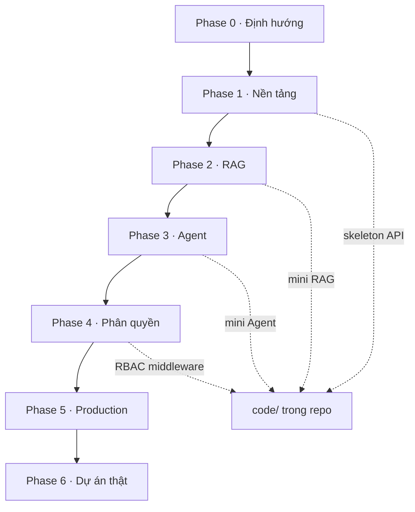

# 02 — Bản đồ học tập



## Thứ tự ưu tiên kiến thức

```text
Dễ ──────────────────────────────────────────────────────── Khó

[HTTP API] → [CRUD + DB] → [Embed + Search] → [RAG QA]
     → [Agent loop + tools] → [Tenant + RBAC]
     → [Async queue] → [Audit / Security / Deploy]
```

## Ma trận kỹ năng

| Kỹ năng | Phase | Bắt buộc MVP? |
|---------|-------|---------------|
| REST + JWT | 1 | Có |
| Schema User/Tenant/KB | 1 | Có |
| Chunk + Embedding | 2 | Có |
| Hybrid search (vector ± keyword) | 2 | Vector bắt buộc; keyword khuyến nghị |
| Citation trong answer | 2 | Có |
| ReAct + tool calling | 3 | Có |
| SSE streaming | 3 | Nên có |
| RBAC 4 cấp | 4 | Có |
| Resource ownership | 4 | Có |
| API Key scoped | 4 | Có |
| Asynq / queue ingest | 5 | Nên (có thể sync tạm ở lab 2) |
| Langfuse / tracing | 5 | Tùy |
| Docker Compose deploy | 5 | Có |

## Nhịp học đề xuất

| Tuần | Việc |
|------|------|
| Tuần 1 | Phase 0–1: đọc + skeleton |
| Tuần 2 | Phase 2: mini RAG end-to-end |
| Tuần 3 | Phase 3: agent + SSE |
| Tuần 4 | Phase 4: tenant + RBAC + API Key |
| Tuần 5 | Phase 5–6: harden + viết blueprint riêng |

## Quy tắc “không làm vội”

| Sai lầm thường gặp | Hệ quả | Cách tránh |
|--------------------|--------|------------|
| Code Agent trước khi search chạy | Không biết tool trả gì | Xong lab RAG trước |
| Gắn `user_id` thẳng vào KB, bỏ tenant | Không scale multi-team | Tenant là cột bắt buộc từ Phase 1 |
| Role chỉ check ở frontend | Lỗ hổng bảo mật | Middleware + service layer |
| Copy nguyên WeKnora | Quá nặng, không hiểu | Mỗi lab chỉ lấy *ý tưởng* |

## Liên kết tiếp

→ [03 — Map sang WeKnora](./03-map-sang-weknora.md)
