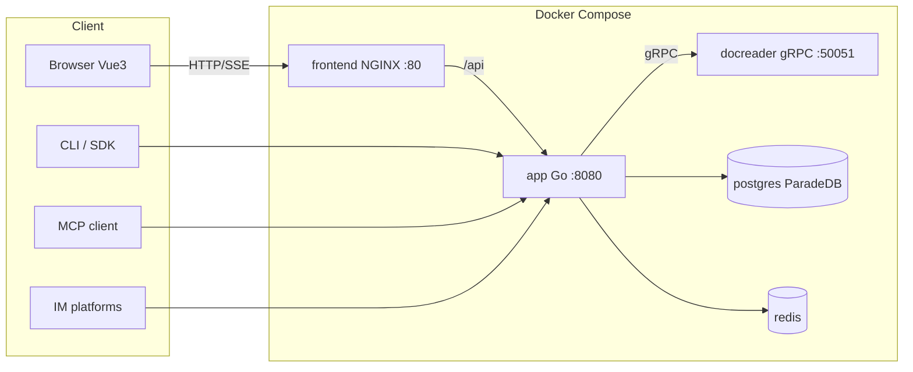
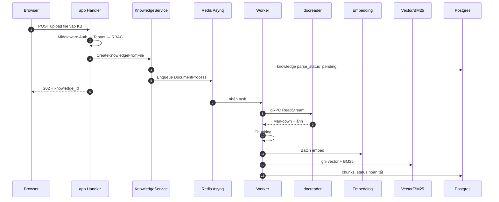

# Tổng quan kiến trúc WeKnora

> Bản dịch tiếng Việt phục vụ học Phase 0.  
> Nguồn: `WeKnora/website-docs/02-architecture/01-overview.md`  
> MVP của `rag-agent-enterprise` chỉ cần nắm **5 service core** + sơ đồ request; phần profile/optional đọc lướt.

WeKnora gồm Web frontend, dịch vụ chính Go, và dịch vụ parse tài liệu Python; dùng database lưu nghiệp vụ, Redis điều phối tác vụ bất đồng bộ. Vector store, object storage, knowledge graph và model service cấu hình theo nhu cầu triển khai.

## 1. Thành phần hệ thống

Kiến trúc lõi: **3 process** (app + frontend + docreader) + **2 hạ tầng** (PostgreSQL, Redis). Các thành phần còn lại (vector DB độc lập, knowledge graph, web search…) là **tùy chọn**, bật bằng Docker Compose profile.

### 1.1. Service lõi (mặc định khởi động)

| Service     | Image / build                                            | Port                             | Trách nhiệm                                                                                                     |
| ----------- | -------------------------------------------------------- | -------------------------------- | --------------------------------------------------------------------------------------------------------------- |
| `app`       | `wechatopenai/weknora-app` (`docker/Dockerfile.app`, Go) | `8080`                           | Backend chính: REST API, RAG, Agent engine, worker bất đồng bộ, kênh IM/Embed. Health: `GET /health`            |
| `frontend`  | `wechatopenai/weknora-ui` (`frontend/`, NGINX + Vue3)    | `80`                             | Web UI; NGINX reverse proxy `/api` → `app`                                                                      |
| `docreader` | `wechatopenai/weknora-docreader` (Python)                | `50051` (chỉ trong mạng compose) | Microservice parse tài liệu qua gRPC: PDF/DOCX/Excel/EPUB/web… 25+ định dạng                                    |
| `postgres`  | `paradedb/paradedb:v0.22.6-pg17`                         | `5432`                           | DB chính. ParadeDB có sẵn BM25 + pgvector → **mặc định không cần vector DB riêng** (`RETRIEVE_DRIVER=postgres`) |
| `redis`     | `redis:7.0-alpine`                                       | `6379`                           | Hàng đợi Asynq, quản lý SSE (đa instance), Pub/Sub `system_settings`, rate limit, cổng concurrent theo model    |
| `sandbox`   | `wechatopenai/weknora-sandbox`                           | —                                | Image chạy Agent Skills (Docker / Cube / E2B)                                                                   |

`app` và `docreader` chia sẻ volume `docreader-tmp` (`/tmp/docreader`) để truyền ảnh parse; file local của `app` nằm ở `data-files` (`/data/files`).

### 1.2. Component tùy chọn (Compose profile)

| Service                          | Profile            | Dùng để                                  |
| -------------------------------- | ------------------ | ---------------------------------------- |
| `searxng`                        | `searxng` / `full` | Meta-search tự host cho Agent Web Search |
| `neo4j`                          | `neo4j` / `full`   | Knowledge graph (GraphRAG)               |
| `minio`                          | `minio` / `full`   | Object storage                           |
| `qdrant` / `milvus` / `weaviate` | cùng tên           | Vector DB độc lập                        |
| `doris-fe` + `doris-be`          | `doris`            | Apache Doris làm engine tìm kiếm         |
| `odl-hybrid`                     | `odl-hybrid`       | Backend parse PDF hỗn hợp                |
| `dex`                            | `dex` / `full`     | IdP OIDC để test                         |
| `langfuse-`*                     | `langfuse`         | Observability LLM                        |

Backend Go còn có thể nối engine ngoài compose: Elasticsearch, OpenSearch, Tencent VectorDB, và nhiều loại object storage.

### 1.3. Hình thái triển khai

- **Lite**: SQLite + sqlite-vec, không Redis (Asynq chạy sync trong process), frontend nhúng trong binary Go  
- **Desktop**: Wails v2 (`cmd/desktop`), sandbox OS (hiện macOS)  
- **Kubernetes**: `helm/` · **Bare metal**: `deploy/` systemd

> **Với MVP học:** chỉ cần tưởng tượng `app` + `postgres` (+ `redis` sau). Không cần `frontend`/`docreader` tách process ngay.

## 2. Tech stack (tóm tắt)

| Lớp         | Công nghệ                               |
| ----------- | --------------------------------------- |
| Backend     | Go, Gin, GORM, dig (DI)                 |
| Queue       | Asynq + Redis                           |
| Auth        | JWT / X-API-Key / OIDC                  |
| Vector      | pgvector (mặc định) + nhiều driver khác |
| Frontend    | Vue 3 + TDesign + Vite                  |
| Doc parse   | Python gRPC (`docreader/`)              |
| Agent tools | MCP (`mcp-go`), sandbox, IM…            |

## 3. Giao tiếp giữa process

| Liên kết                 | Protocol        | Ghi chú                         |
| ------------------------ | --------------- | ------------------------------- |
| Browser → frontend → app | HTTP + **SSE**  | Chat stream                     |
| app → docreader          | **gRPC**        | `ReadStream` file lớn           |
| app → postgres           | SQL             | Business + BM25 + vector        |
| app ↔ redis              | RESP            | Queue, SSE, Pub/Sub, rate limit |
| MCP client → app         | Streamable HTTP | Expose KB search ra ngoài       |
| IM ↔ app                 | Webhook / SDK   | WeCom, Feishu, Slack…           |

## 4. Sơ đồ tổng thể

## 5. Luồng điển hình: upload → index

**Chat** (`knowledge-chat` / `agent-chat`): đồng bộ SSE — Handler → SessionService → `chat_pipeline` (hiểu query → retrieve song song → rerank → prompt → LLM stream).

## 6. Cấu trúc thư mục repo (đọc thuộc tên)

| Thư mục                       | Việc                                                                |
| ----------------------------- | ------------------------------------------------------------------- |
| `cmd/`                        | Entry: server, desktop…                                             |
| `internal/`                   | Toàn bộ backend Go (handler / service / repo / agent / middleware…) |
| `frontend/`                   | Vue3 UI                                                             |
| `docreader/`                  | Parse Python gRPC                                                   |
| `cli/`, `client/`             | CLI + Go SDK                                                        |
| `migrations/`                 | SQL migrate                                                         |
| `config/`                     | YAML cấu hình + prompt                                              |
| `docker/`, `helm/`, `deploy/` | Triển khai                                                          |

---

## Điểm cần nhớ cho Phase 0 (checklist)

1. Năm service core: **app, frontend, docreader, postgres, redis**.
2. Request luôn qua **Auth → Tenant → RBAC** trước khi vào business.
3. Upload là **async** (queue); chat là **SSE sync**.
4. MVP học có thể gộp parse vào process API, bỏ frontend/docreader riêng.

→ Tiếp: [Tenant, user & phân quyền (VI)](./01-tenant-auth.vi.md)