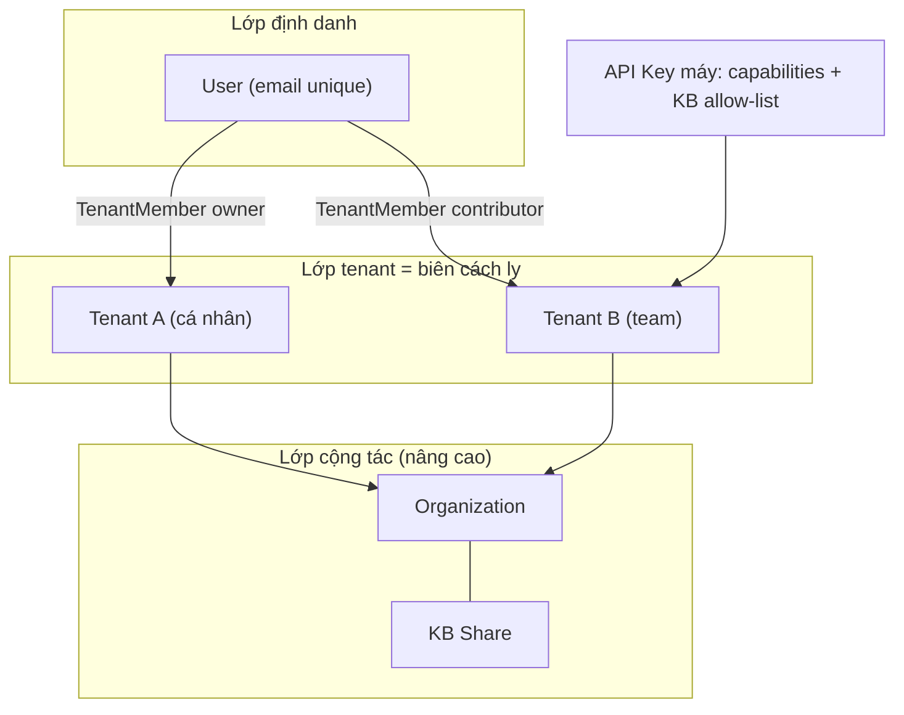

# Tenant, user và xác thực / phân quyền

> Bản dịch tiếng Việt (rút gọn có chủ đích cho học Phase 0–4).  
> Nguồn: `WeKnora/website-docs/03-features/01-tenant-auth.md`  
> Phần Organization / OIDC / JWT chi tiết chỉ tóm tắt — khi vào Phase 4 đọc thêm file gốc nếu cần.

**Workspace (không gian)** là biên giới tài nguyên và quyền của WeKnora. Knowledge base, model, agent, session và hạn mức lưu trữ đều thuộc một không gian. Một user có thể tham gia nhiều không gian với **role khác nhau**. Backend gọi không gian là **Tenant**.

| Thao tác | Cách làm |
| --- | --- |
| Mời thành viên | Cài đặt không gian → Thành viên → Mời + chọn role (Owner / Admin / Contributor / Viewer) |
| Chia sẻ KB cho team khác | Tạo Organization → thêm cả hai không gian → Share KB vào org |
| Gọi API bằng máy | Cài đặt → API Key → chọn capability (retrieve / chat / ingest / manage…) + có thể giới hạn KB |
| Quản trị cả cụm triển khai | Cần **System Admin** (khác Owner của một không gian) |
| Xóa cả không gian | Chỉ **Owner** (`DELETE /tenants/:id`) — soft-delete; thành viên mất quyền ngay |

**Tóm tắt role:** Viewer xem + hỏi; Contributor tạo KB + upload; Admin quản lý cấu hình không gian; Owner còn xóa/chuyển không gian. Sửa resource còn bị ràng buộc **ownership** (ai tạo resource).

Người đăng nhập bằng mật khẩu hoặc OIDC; chương trình dùng **API Key**. Quyền user = role + ownership; quyền máy = capabilities + KB allow-list.

---

## 1. Khái niệm tổng quan

**Ba điểm then chốt:**

1. Một User thuộc nhiều Tenant qua bảng `tenant_members`, mỗi quan hệ một role.  
2. Organization chia sẻ ở mức **tenant** (không gian A share KB cho org), không tự nâng role user.  
3. **API Key ≠ bậc Owner** — là principal máy riêng, không đi theo thang role người.

---

## 2. Mời thành viên & phân role

Trong «Thành viên» của không gian: mời user, gán role theo phạm vi công việc. User nhận lời mời → vào không gian hiện tại. Khi tắt đăng ký công khai, có thể đăng ký bằng lời mời hợp lệ. User đã có tài khoản chỉ cần accept invite — không tạo account thứ hai.

Role thành viên không gian và role trong Organization **tách nhau**. Khi dùng tài liệu share: phải xét đồng thời quyền share KB + role org của không gian nhận + role của user trong không gian mình.

---

## 3. Share KB / Agent (đọc lướt ở Phase 0)

1. Đưa không gian nguồn và nhận vào cùng Organization.  
2. Thành viên đủ quyền share KB/Agent vào org.  
3. Quyền thực tế bên nhận = **giao của** quyền share ∩ role org ∩ (có thể bị **cap** xuống Viewer nếu user chỉ là Viewer trong tenant của họ).

Share **không** tự nâng user lên Contributor/Admin.

> MVP `rag-agent-enterprise` **chưa** làm Organization share — chỉ cần hiểu ý tưởng cách ly tenant.

---

## 4. API Key cho chương trình

Tạo API Key trong cài đặt không gian: chọn capability theo việc (retrieve / chat-qa / ingest / manage…). Có thể giới hạn danh sách KB. Client gửi header `X-API-Key`.

**Default-deny:** route không khai báo policy cho API Key → từ chối.

### Capability chính (rút gọn)

| Capability | Ý nghĩa |
| --- | --- |
| `retrieve` | Đọc / search KB |
| `chat` | Session + knowledge-chat / agent-chat |
| `ingest` | Upload / sửa nội dung |
| `manage_kbs` | Vòng đời KB |
| `manage_members` | Thành viên / invite |
| … | Nhiều capability quản trị khác (model, MCP, platform…) |

**KB allow-list:** nếu key có danh sách KB, chỉ được đụng KB trong list; batch có 1 KB ngoài list → 403 cả request.

> MVP học map gần với: `retrieve` / `qa` / `ingest` / `admin` (xem `app/access/rbac.py`).

---

## 5. Ma trận RBAC (học thuộc)

Ủy quyền WeKnora gồm **ba cơ chế trực giao**:

1. **Role guard** — role trong tenant là gì? (`Viewer` / `Contributor` / `Admin` / `Owner`)  
2. **Ownership guard** — có phải người tạo resource, hoặc Admin+ không?  
3. **KB access guard** — tenant có chạm được KB này không? (sở hữu / org share / qua shared agent)

### 5.1. Bảng năng lực theo role

| Năng lực | Owner | Admin | Contributor | Viewer |
| --- | --- | --- | --- | --- |
| Xóa tenant / chuyển ownership / quản lý API Key | ✓ | ✗ | ✗ | ✗ |
| Thêm/xóa member, đổi role, gửi invite | ✓ | ✗* | ✗ | ✗ |
| Cấu hình hạ tầng tenant (model, vector, IM…) | ✓ | ✓ | ✗ | ✗ |
| Xóa sạch nội dung KB | ✓ | ✓ | ✗ | ✗ |
| Sửa/xóa KB/Agent **của người khác** | ✓ | ✓ | ✗ | ✗ |
| Tạo KB / Agent; sửa resource **mình tạo** | ✓ | ✓ | ✓ | ✗ |
| Tạo session, hỏi đáp (chat / agent) | ✓ | ✓ | ✓ | ✓ |
| Xem list member / KB / search / preview | ✓ | ✓ | ✓ | ✓ |

\* Trong WeKnora gốc, **invite/đổi role member là Owner-only** (Admin cũng không). MVP học của bạn có thể nới Admin+ cho dễ lab — nhớ ghi chú khác biệt.

**Ngữ nghĩa sản phẩm:**

- Owner / Admin: quản lý gần như mọi thứ trong tenant (trừ điểm Owner-only).  
- Contributor: quản lý resource **mình tạo**; resource người khác = read-only.  
- Viewer: chủ yếu đọc + hỏi; **vẫn tạo được session** (dữ liệu làm việc của mình), nhưng **không** tạo KB/Agent.

### 5.2. Vì sao Viewer không upload?

Upload/sửa KB thuộc Contributor+ (và thường kèm ownership). Giữ Viewer hẹp để mời người chỉ hỏi đáp mà không mở quyền ghi tài liệu.

---

## 6. Đăng ký / đăng nhập (tóm tắt)

| Chế độ | Ý nghĩa |
| --- | --- |
| `self_serve` | Đăng ký công khai (mặc định) |
| `invite_only` | Chặn `POST /auth/register` mật khẩu; vẫn cho phép register-by-invite / OIDC (nếu bật) |

`DefaultTenantMode`:

- `create_personal` — đăng ký xong tự tạo tenant cá nhân (Owner)  
- `tenantless` — chưa có tenant, chờ invite  

Luồng quen thuộc:

- `POST /auth/register` → user (+ personal tenant)  
- `POST /auth/login` → JWT (+ refresh)  
- `GET /auth/me` → user + memberships  

---

## 7. JWT & principal máy (ý chính)

- User: `Authorization: Bearer <access_token>`  
- Máy: `X-API-Key: <key>`  
- Hai principal **không trộn** thang quyền: API Key không “hóa thân” thành Owner để bypass ownership check theo kiểu user.

---

## 8. Checklist Phase 0 (tự trả lời)

1. Tenant là gì? Vì sao là biên giới tài nguyên?  
2. Nêu 4 role và ai được upload.  
3. API Key `retrieve` có được chat không? Vì sao?  
4. User thuộc 2 tenant — role lưu ở đâu?  
5. Ownership khác role chỗ nào?

---

## 9. Map sang code MVP của bạn

| WeKnora | `rag-agent-enterprise` |
| --- | --- |
| Tenant + TenantMember | `tenants`, `tenant_members` |
| Role matrix | `app/access/rbac.py` |
| JWT / API Key | `app/api/deps.py`, `app/services/apikey.py` |
| Invite member | `POST /tenants/{id}/members/invite` |
| Audit | `app/services/audit.py` |

File gốc đầy đủ (Organization, OIDC sequence, JWT refresh, data model chi tiết):  
`/Users/mac/Desktop/Projects/Learn/AI/WeKnora/website-docs/03-features/01-tenant-auth.md`

→ Quay lại note: [04-note-kien-truc.md](../04-note-kien-truc.md)
