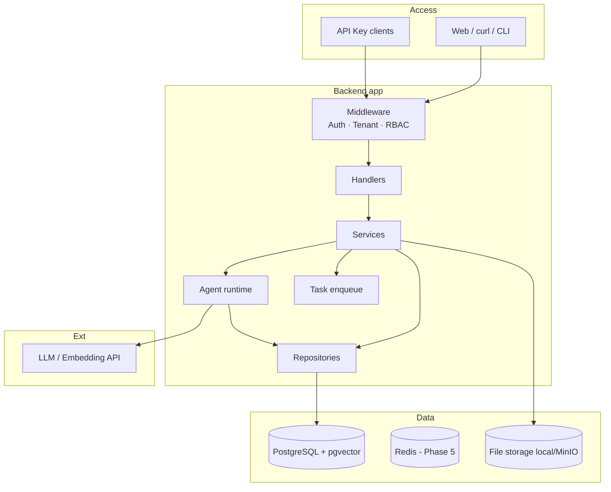

# 01 — Kiến trúc tổng quan

## Mục tiêu bài

Hiểu “hình dạng” hệ thống doanh nghiệp trước khi viết code — tránh nhồi mọi thứ vào một file `main`.

## Kiến trúc mục tiêu (MVP của bạn)



So với WeKnora đầy đủ, MVP **gom** docreader vào process chính (parse Markdown/TXT trước), **chưa** tách microservice Python.

## 4 lớp bắt buộc (học từ WeKnora)

| Lớp | Việc được làm | Việc **không** được làm |
|-----|---------------|-------------------------|
| Middleware | Auth, gắn `tenant_id` vào context, check role tối thiểu | Business rules phức tạp |
| Handler | Parse input, validate, gọi service, trả JSON | SQL trực tiếp |
| Service | Orchestration, transaction, gọi LLM/agent | Phụ thuộc Gin/HTTP types |
| Repository | SQL/GORM, query vector | Quyết định authorization |

Authorization “đúng chỗ”:

- **Gate thô** ở middleware (đã login? đúng tenant? role ≥ Viewer?)
- **Gate mịn** ở service/access layer (KB này có thuộc tenant? user có ownership/share?)

WeKnora tách `internal/application/access/` đúng vì lý do này.

## Envelope API (gợi ý học từ CLI WeKnora)

Success:

```json
{ "ok": true, "data": { "id": "kb_..." }, "meta": {} }
```

Error:

```json
{
  "ok": false,
  "error": {
    "type": "auth.forbidden",
    "message": "viewer cannot upload",
    "hint": "ask an admin to upgrade your role"
  }
}
```

Typed error giúp frontend và agent CLI xử lý thống nhất — xem `cli/AGENTS.md` trong WeKnora.

## Context xuyên suốt request

Mỗi request sau auth nên có trong `context.Context`:

| Key | Ý nghĩa |
|-----|---------|
| `user_id` | Ai đang gọi |
| `tenant_id` | Workspace đang active |
| `role` | Role của user trong tenant đó |
| `principal` | `user` hoặc `api_key` |
| `request_id` | Trace / log |

Thiếu `tenant_id` → **không** được query KB (tránh leak cross-tenant).

## Câu tự kiểm

1. Handler được phép gọi GORM không? Vì sao?  
2. Tại sao `tenant_id` phải nằm trong context, không chỉ trong JWT body để “tin tưởng mù”?  
3. Phân biệt gate thô vs gate mịn bằng 1 ví dụ upload document.

## Tiếp

→ [02 — Stack và lựa chọn](./02-stack-va-lua-chon.md)
