# 03 — Mô hình dữ liệu cơ bản

## Mục tiêu

Thiết kế schema **đủ** cho multi-tenant + RBAC trước khi viết RAG. Sai schema ở đây = sửa đau ở Phase 4.

## Sơ đồ quan hệ (MVP)

```mermaid
erDiagram
    USER ||--o{ TENANT_MEMBER : joins
    TENANT ||--o{ TENANT_MEMBER : has
    TENANT ||--o{ KNOWLEDGE_BASE : owns
    TENANT ||--o{ API_KEY : owns
    USER ||--o{ KNOWLEDGE_BASE : creates
    KNOWLEDGE_BASE ||--o{ DOCUMENT : contains
    DOCUMENT ||--o{ CHUNK : splits
    TENANT ||--o{ SESSION : owns
    SESSION ||--o{ MESSAGE : has

    USER {
        uuid id PK
        string email UK
        string password_hash
        timestamptz created_at
    }
    TENANT {
        uuid id PK
        string name
        timestamptz created_at
    }
    TENANT_MEMBER {
        uuid tenant_id FK
        uuid user_id FK
        string role
        string status
    }
    KNOWLEDGE_BASE {
        uuid id PK
        uuid tenant_id FK
        uuid owner_user_id FK
        string name
    }
    DOCUMENT {
        uuid id PK
        uuid kb_id FK
        string title
        string parse_status
        string storage_path
    }
    CHUNK {
        uuid id PK
        uuid document_id FK
        int position
        text content
        vector embedding
    }
    API_KEY {
        uuid id PK
        uuid tenant_id FK
        string key_hash
        string capabilities
        uuid[] kb_allowlist
    }
```

## Bốn role (copy tinh thần WeKnora)

| Role | Đọc KB / Chat | Upload / sửa KB | Quản lý member | Xóa workspace |
|------|---------------|-----------------|----------------|---------------|
| Viewer | ✓ | ✗ | ✗ | ✗ |
| Contributor | ✓ | ✓ (KB mình tạo / được share) | ✗ | ✗ |
| Admin | ✓ | ✓ | ✓ (trừ Owner) | ✗ |
| Owner | ✓ | ✓ | ✓ | ✓ |

> Chi tiết ownership tinh chỉnh ở Phase 4. Phase 1 chỉ cần cột `role` và enum hợp lệ.

## Quy tắc vàng về `tenant_id`

1. Mọi bảng tài nguyên nghiệp vụ (`knowledge_bases`, `documents`, `sessions`, `api_keys`) **có** `tenant_id`.  
2. Mọi query list/get **filter** `tenant_id = context.tenant_id`.  
3. ID resource (UUID) **không** đủ — luôn kèm check tenant (tránh IDOR).

## Trạng thái parse (chuẩn bị Phase 2)

`documents.parse_status`: `pending` → `processing` → `completed` | `failed`

## Việc cần làm trong migration Phase 1

Tối thiểu tạo bảng: `users`, `tenants`, `tenant_members`.

Có thể để stub (chưa dùng): `knowledge_bases`, `api_keys`.

## Câu tự kiểm

1. Vì sao `chunks` không nhất thiết có `tenant_id` nếu đã có qua `document → kb`? (trade-off)  
2. `API_KEY` thuộc User hay Tenant? WeKnora chọn gì?  
3. User thuộc 2 tenant — lưu role ở đâu?

## Tiếp

→ [04 — Lab Hello API](./04-lab-hello-api.md)
