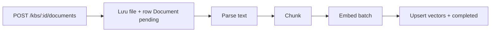

# 01 — Pipeline ingest

## Ý tưởng (từ WeKnora)

HTTP chỉ **nhận file + ghi DB + (tuỳ chọn) enqueue**. Việc nặng (parse, chunk, embed) chạy sync tạm ở lab, rồi tách worker ở Phase 5.

WeKnora: Handler → `TypeDocumentProcess` Asynq → worker `convert → chunk → BatchIndex` → enrichment. Bạn bắt đầu bằng sync trong service `IngestDocument`.

## API tối thiểu

| Method | Path | Role tối thiểu |
|--------|------|----------------|
| POST | `/tenants/:tid/knowledge-bases` | Contributor |
| GET | `/tenants/:tid/knowledge-bases` | Viewer |
| POST | `/knowledge-bases/:kid/documents` | Contributor |
| GET | `/knowledge-bases/:kid/documents` | Viewer |
| GET | `/documents/:did` | Viewer |

Luôn verify: `kb.tenant_id == context.tenant_id`.

## Trạng thái

| parse_status | Ý nghĩa |
|--------------|---------|
| `pending` | Đã nhận, chưa xử lý |
| `processing` | Đang parse/embed |
| `completed` | Sẵn sàng retrieval |
| `failed` | Lỗi + cột `error_message` |

## File storage MVP

Thư mục local: `data/files/{tenant_id}/{kb_id}/{doc_id}`  
Đủ học; MinIO để Phase 5+.

## Câu tự kiểm

1. Vì sao không embed ngay trong Handler?  
2. Hash file (MD5/SHA) dùng để làm gì? (WeKnora có `calculateFileHash`)  
3. Nếu embed fail giữa chừng — status nên là gì?

## Tiếp

→ [02 — Chunking & Embedding](./02-chunking-embedding.md)
