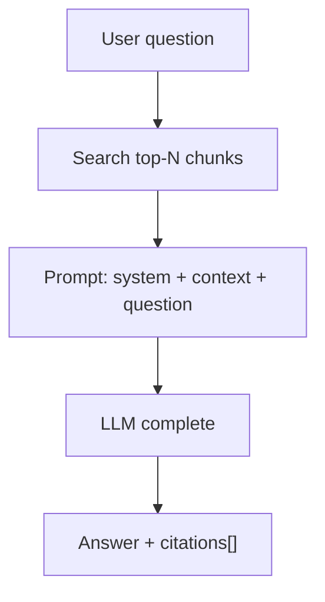

# 04 — QA có citation

## Pipeline RAG tối giản



WeKnora dùng event plugin (`QUERY_UNDERSTAND` → `CHUNK_SEARCH` → `RERANK` → `CHAT_COMPLETION_STREAM`). Bạn gộp 1 hàm `AnswerQuestion(ctx, kbID, question)` trước.

## Prompt skeleton

```text
Bạn là trợ lý nội bộ. Chỉ trả lời dựa trên CONTEXT.
Nếu không đủ thông tin, nói không tìm thấy.
Trích dẫn bằng [n] khớp nguồn.

CONTEXT:
[1] (doc: HD-BH.md) ...
[2] (doc: PL-01.md) ...

QUESTION: ...
```

## Citation contract

```json
{
  "answer": "Bảo hành 12 tháng [1].",
  "citations": [
    {
      "index": 1,
      "document_id": "...",
      "chunk_id": "...",
      "title": "HD-BH.md",
      "snippet": "..."
    }
  ]
}
```

Không tin LLM “tự bịa số [n]” — map citation từ danh sách chunk đã đưa vào prompt.

## Session (tuỳ chọn Phase 2)

Bảng `sessions` / `messages` để lưu lịch sử. MVP có thể stateless từng câu.

## Endpoint

`POST /knowledge-bases/:id/chat`

Role: Viewer+

## Tiếp

→ [05 — Lab Mini RAG](./05-lab-mini-rag.md)
