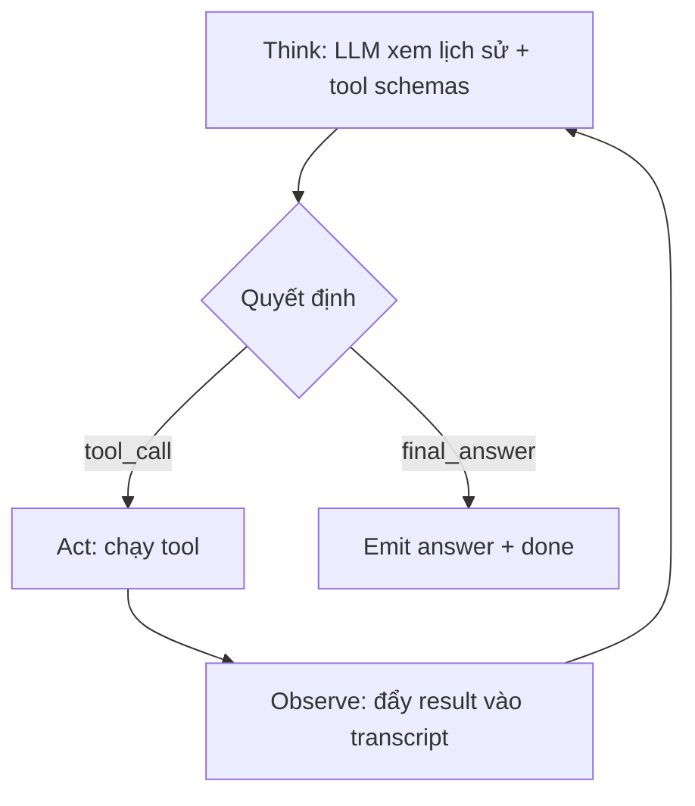

# 02 — Vòng ReAct

## Vòng lặp



WeKnora: `internal/agent` với think / act / observe tách file — bạn có thể 1 file `loop.go` cho lab.

## Pseudo-code

```text
messages = [system, user_question]
for step in 1..max_steps:
  resp = llm.chat(messages, tools=registry.schemas())
  if resp.tool_calls:
    for call in resp.tool_calls:
      if not allow(ctx, call): return forbidden
      result = registry.execute(ctx, call)
      messages.append(tool_result)
      emit(tool_call_event)
    continue
  emit(answer)
  return
emit(error max_steps)
```

## Tham số an toàn

| Tham số | Gợi ý |
|---------|--------|
| `max_steps` | 6–12 |
| `tool_timeout` | 15–30s |
| `max_tool_result_chars` | truncate 8–16k |

## System prompt Agent

Nhắc model: ưu tiên search trước khi trả lời; không bịa; nêu khi thiếu quyền/dữ liệu.

## Tiếp

→ [03 — Tools và MCP](./03-tools-va-mcp.md)
