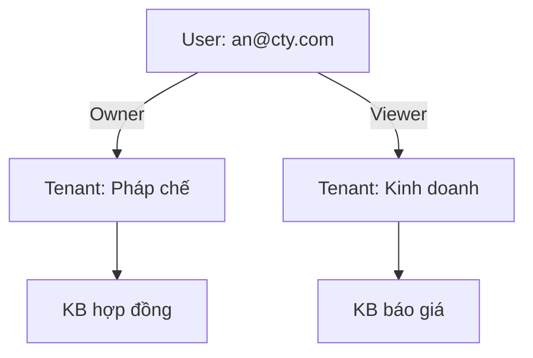

# 01 — Multi-tenant

## Định nghĩa

**Tenant / Workspace** = biên giới tài nguyên và quota.  
Một User có thể thuộc nhiều Tenant với role khác nhau.

WeKnora gọi workspace là `Tenant` trong backend.

## Active tenant

JWT mang `user_id` (+ có thể `active_tenant_id`).  
Mọi request nghiệp vụ:

1. Xác định tenant đang làm việc (header `X-Tenant-ID` hoặc path `/tenants/:id/...`)  
2. Middleware `PathTenantMatch`: URL tenant == membership active  
3. Gắn vào context  

Đổi workspace = đổi active tenant (API `POST /me/active-tenant`).

## Isolation checklist

| Kiểm tra | Cách |
|----------|------|
| List KB | `WHERE tenant_id = ?` |
| Get by UUID | Join/filter tenant — UUID đoán được vẫn 404 |
| Upload path | Thư mục có `tenant_id` |
| Vector search | Filter `tenant_id` (+ `kb_id`) |
| Agent tool | Nhận context, không nhận “trust client kb list” mù |

## Tổ chức (Organization) — học ý, làm sau

WeKnora: nhiều tenant trong một Organization để **share** KB.  
MVP: chưa cần org — chỉ RBAC trong 1 tenant + chưa share cross-tenant.

## KB trong tenant — vượt “túi file”

Isolation theo `tenant_id` (+ `kb_id`) là **điều kiện cần**, chưa đủ cho DN: vẫn có thể hỏi đúng workspace nhưng **sai miền KB**.  
Phân tích + phương án: [../06-xay-du-an/05-kb-vuot-demo.md](../06-xay-du-an/05-kb-vuot-demo.md).

## Tiếp

→ [02 — RBAC 4 cấp](./02-rbac-4-cap.md)
