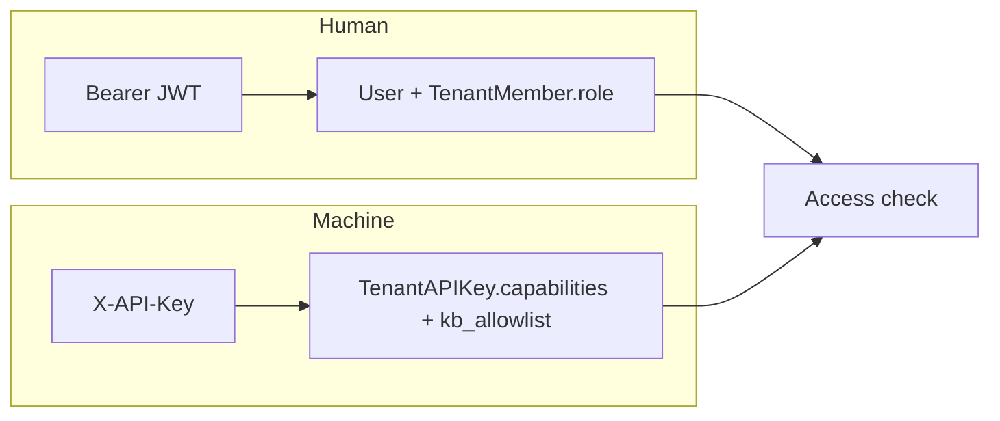

# 03 — Auth JWT và API Key

## Hai principal

**Không** gán API Key = role Owner. Key là máy, cấp theo **capability**.

## JWT

| Claim | Mục đích |
|-------|----------|
| `sub` | user_id |
| `tid` | active tenant (optional — có thể chỉ dùng header) |
| `exp` | hết hạn ngắn (15–60 phút) |
| refresh | xoay token, lưu hash server-side nếu cần revoke |

Middleware Auth: parse JWT **hoặc** API Key (một trong hai).

## API Key capabilities (gợi ý WeKnora)

| Capability | Cho phép |
|------------|----------|
| `retrieve` | search / list docs |
| `qa` | chat RAG |
| `agent` | agent chat |
| `ingest` | upload / reparse |
| `admin` | quản trị (hiếm khi cấp cho máy) |

Ví dụ: key chỉ `retrieve` gọi `/chat` → `auth.forbidden`.

## KB allow-list

Key có thể bị giới hạn `kb_ids[]`.  
Rỗng = toàn bộ KB trong tenant (nếu policy cho phép).  
Có list = chỉ những KB đó.

## Lưu trữ key

- Chỉ lưu **hash** (sha256) trên DB  
- Hiển thị secret **một lần** lúc tạo  
- Prefix `rae_` + random để rotate/revoke dễ

## OIDC (backlog)

WeKnora hỗ trợ OIDC/JWKS cho SSO doanh nghiệp. MVP password đủ; ghi vào Phase 6.

## Tiếp

→ [04 — Ownership](./04-ownership.md)
