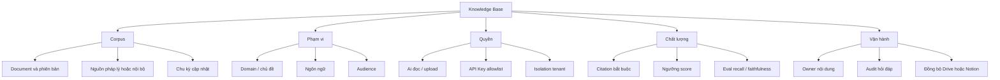
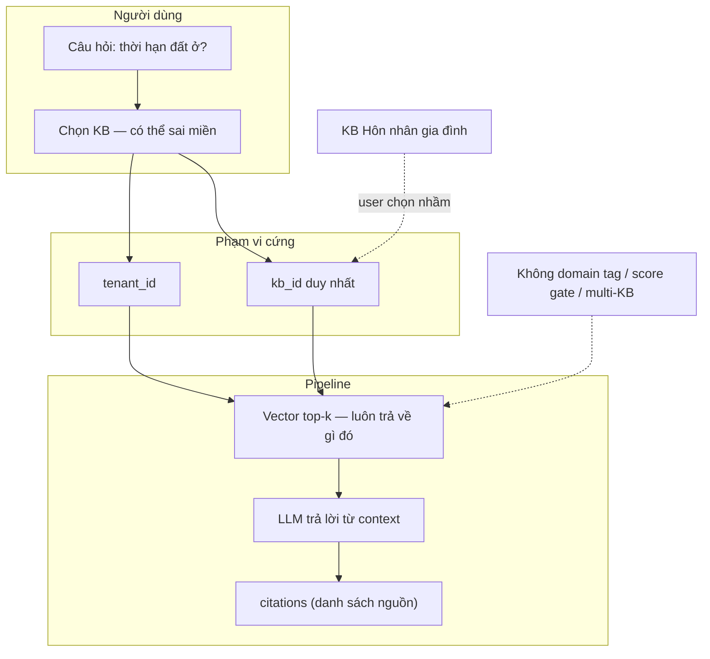
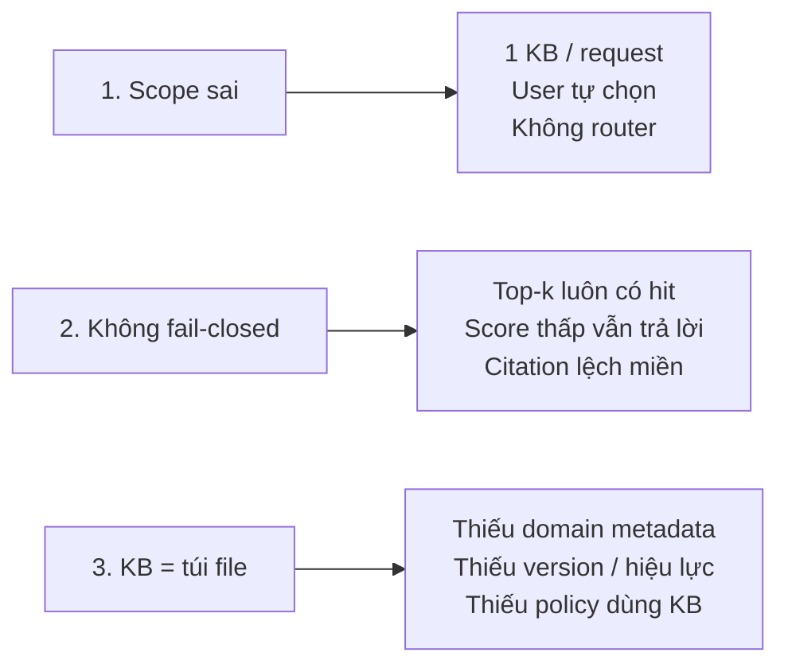
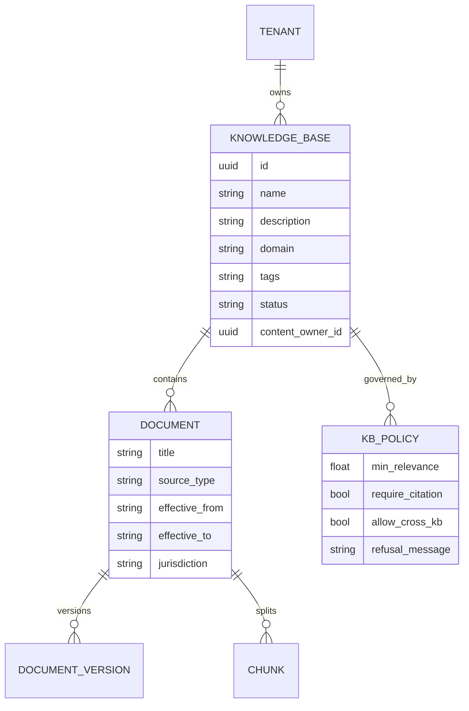
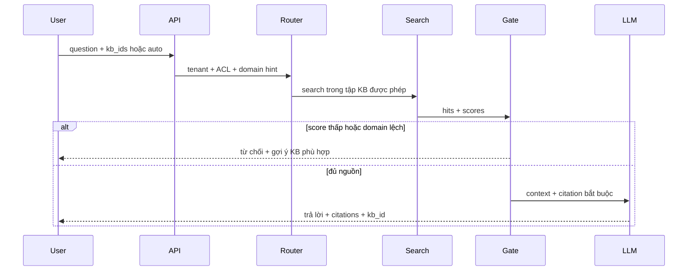
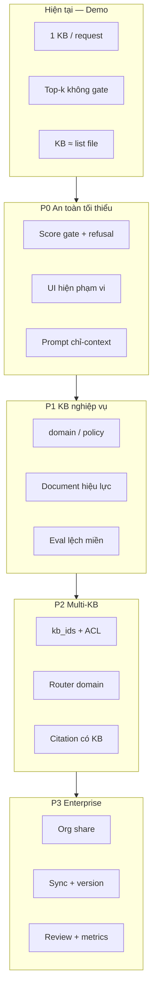

# 05 — KB vượt demo: vấn đề thật & phương án doanh nghiệp

> MVP hiện tại đủ **trình diễn** (upload → search → chat citation trong 1 KB).  
> Để **áp dụng doanh nghiệp**, KB không còn là “hộp chứa vài file” — mà là đơn vị **phạm vi kiến thức, quyền, chất lượng và trách nhiệm pháp lý** của câu trả lời.

## 1. Nhận định thẳng

| Góc nhìn | MVP hôm nay | Doanh nghiệp cần |
|----------|-------------|------------------|
| KB là gì? | Tên + list document | Miền nghiệp vụ + chính sách dùng + chủ sở hữu nội dung |
| Chọn KB | User chọn tay 1 `kb_id` | Đúng miền, hoặc multi-KB có kiểm soát; sai miền phải từ chối |
| Search | Top-k vector trong 1 KB | Ngưỡng relevance + hybrid + (tuỳ chọn) rerank |
| Sai nguồn | Vẫn trả lời / citation “có vẻ đúng” | Fail closed: “thiếu nguồn phù hợp” + audit |
| Giá trị | Demo pipeline RAG | Tin cậy được cho quyết định / tuân thủ |

Không nâng cấp các điểm dưới đây → sản phẩm vẫn chỉ là **lab trình diễn**.

## 2. KB không chỉ nằm trong file

File chỉ là **một lớp**. Thiếu các lớp còn lại thì hỏi “đất đai” trên KB “hôn nhân” vẫn chạy — và đó là lỗi sản phẩm, không phải lỗi user “chưa hiểu”.

## 3. Mô hình hiện tại (MVP) — chỗ vỡ

### Ba lỗ hổng chính

| Lỗ hổng | Ví dụ Pháp chế | Hệ quả DN |
|---------|----------------|-----------|
| Scope sai | Hỏi đất đai trên KB HN-GĐ | Tư vấn sai, rủi ro pháp lý |
| Không fail-closed | Chunk “thời hạn” hôn nhân vẫn top-k | Trông có nguồn nhưng vô nghĩa |
| KB = túi file | Trộn NĐ đất đai + SOP HR cùng KB | Nhiễu retrieval, không audit theo miền |

## 4. Cấu trúc KB “chuẩn” (mục tiêu doanh nghiệp)

Không phải schema file đẹp hơn — mà là **hợp đồng phạm vi** giữa sản phẩm và người dùng.

### Quy ước tổ chức (áp dụng ngay cả khi chưa code đủ)

| Quy tắc | Đúng | Sai |
|---------|------|-----|
| Một KB ≈ một miền / một mục đích đọc | `Luật Đất đai`, `Hôn nhân gia đình` | `Tất cả luật VN` |
| Description = phạm vi + loại trừ | “NĐ/TT đất đai; không gồm HN-GĐ” | Để trống |
| Document đồng mức tin cậy | Văn bản pháp quy + policy đất đai | Trộn FAQ marketing |
| Workspace ≠ KB | Phòng Pháp chế có nhiều KB | Một workspace = một túi file |

## 5. Luồng mục tiêu (sau cải thiện)

## 6. Phương án cải thiện (ưu tiên)

### P0 — Biến demo thành “an toàn tối thiểu” (1–2 tuần lab)

| Hạng mục | Việc làm | Giá trị |
|----------|----------|---------|
| Relevance gate | Từ chối khi `max(score) < threshold` | Giảm trả lời lệch miền |
| Prompt cứng | Chỉ trả lời từ context; thiếu thì nói thiếu nguồn | Giảm bịa |
| UI phạm vi | Luôn hiện “Đang hỏi trong: {KB name + description}” | Giảm chọn nhầm |
| Quy ước KB | Checklist tạo KB: name / domain / loại trừ | Tổ chức corpus |

### P1 — KB có nghĩa nghiệp vụ

| Hạng mục | Việc làm |
|----------|----------|
| Metadata KB | `domain`, `tags[]`, `content_owner`, `status` (draft/active/archived) |
| Policy KB | `min_relevance`, `require_citation`, `refusal_message` |
| Document lifecycle | `effective_from` / `effective_to`, `source_type` (law / policy / faq) |
| Eval tối thiểu | Bộ câu hỏi vàng theo domain + log “từ chối đúng khi lệch KB” |

### P2 — Multi-KB có kiểm soát

| Hạng mục | Việc làm |
|----------|----------|
| API | `kb_ids[]` hoặc mode `all_in_tenant` (vẫn filter `tenant_id` + ACL) |
| Router | Gợi ý / chọn KB theo domain câu hỏi (rule hoặc LLM nhẹ) |
| Citation | Mỗi hit gắn `kb_id` + tên KB — user thấy nguồn thuộc kho nào |
| API Key | `kb_allowlist` bắt buộc khi multi-KB |

### P3 — Lớp doanh nghiệp

| Hạng mục | Việc làm |
|----------|----------|
| Share / Org | Share KB giữa tenant trong Organization (ý WeKnora) |
| Đồng bộ | Drive/Notion + versioning |
| Human review | Flag câu trả lời rủi ro cao (pháp chế) |
| Observability | Trace retrieval score, refusal rate, KB hit distribution |

## 7. Tiêu chí “có giá trị DN” (Definition of Done)

Coi là vượt demo khi **đồng thời** đúng:

1. Chọn / hỏi lệch miền (đất đai ↔ HN-GĐ) → hệ thống **từ chối** hoặc yêu cầu đổi KB, không bịa.  
2. Mỗi câu trả lời có citation thuộc KB được phép; audit được tenant + kb + user.  
3. Có thể hỏi tổng hợp **nhiều KB cùng workspace** mà vẫn giữ ACL.  
4. Mỗi KB có chủ sở hữu nội dung + mô tả phạm vi; document có trạng thái hiệu lực tối thiểu.  
5. Có bộ câu hỏi vàng + đo refusal / faithfulness (dù thủ công ban đầu).

## 8. Việc không làm trong MVP (nhắc lại)

- Không coi “đã có upload + chat” = sẵn sàng production pháp chế.  
- Không mở search toàn DB bỏ `tenant_id`.  
- Không multi-KB mà bỏ `kb_allowlist` trên API Key.

## Tiếp

- Blueprint sản phẩm: [01-blueprint.md](./01-blueprint.md)  
- Milestone: [02-milestone.md](./02-milestone.md) (bổ sung M6)  
- Schema nền: [../01-nen-tang/03-mo-hinh-du-lieu.md](../01-nen-tang/03-mo-hinh-du-lieu.md)  
- Isolation: [../04-phan-quyen/01-multi-tenant.md](../04-phan-quyen/01-multi-tenant.md)
